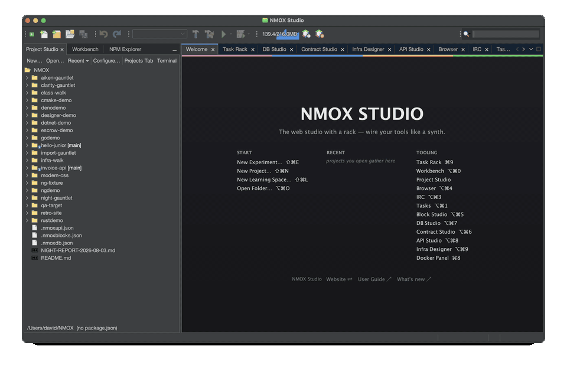
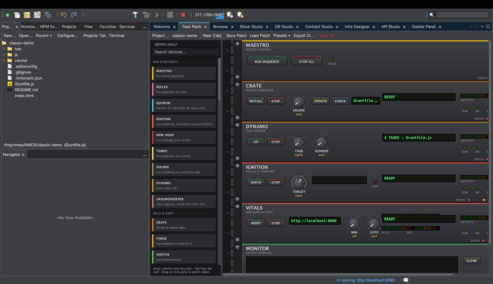
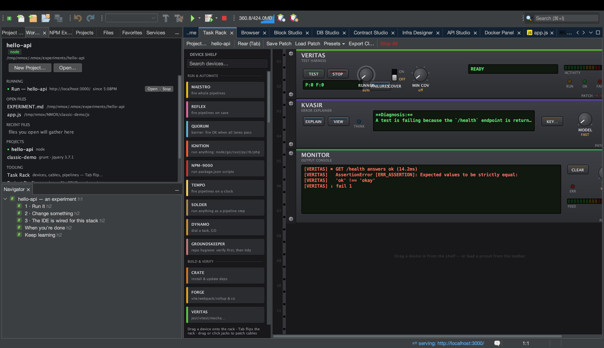
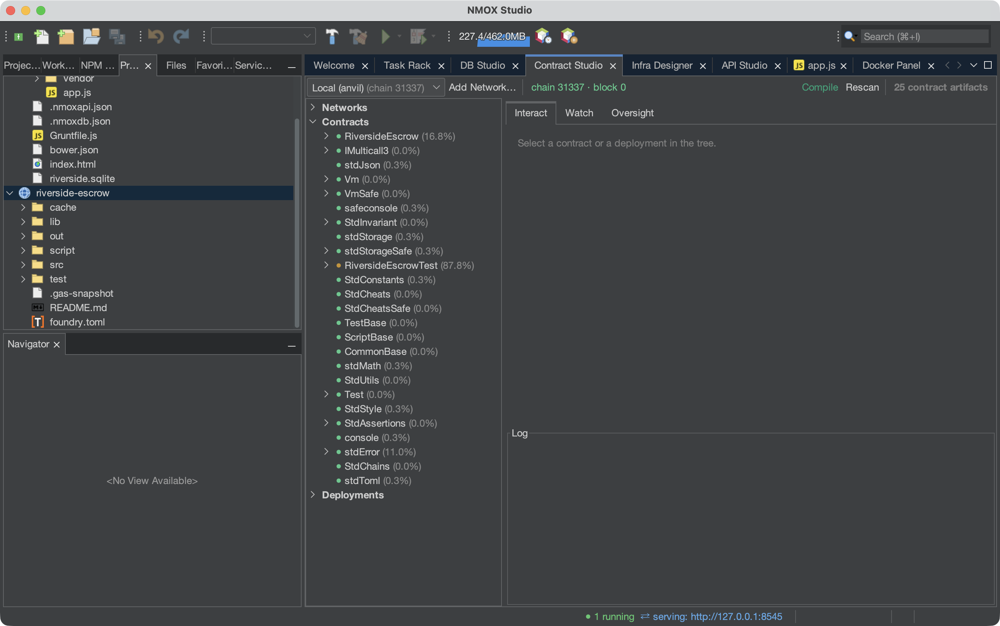
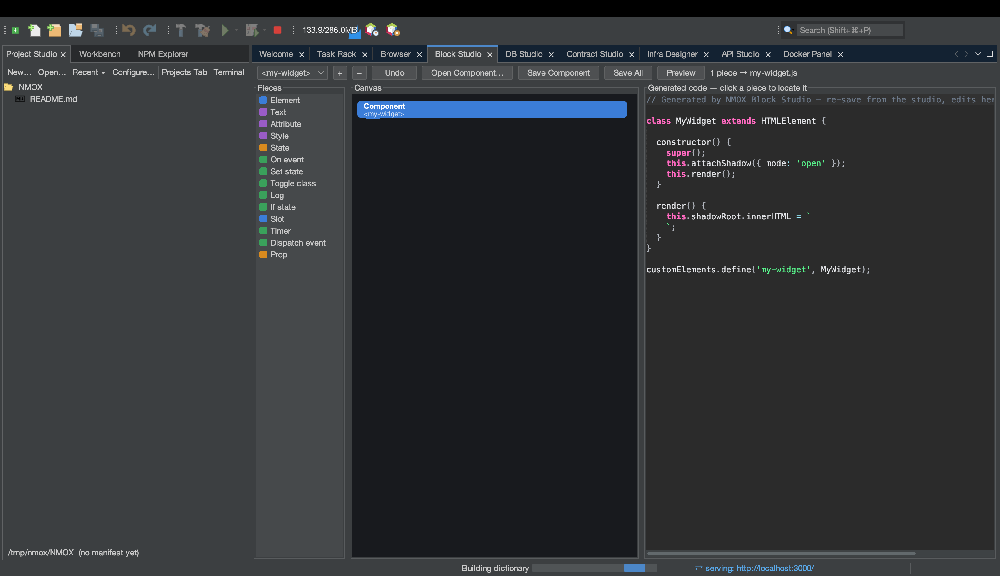
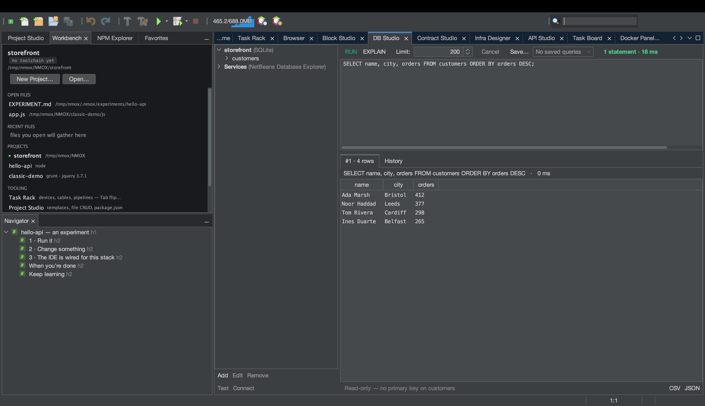
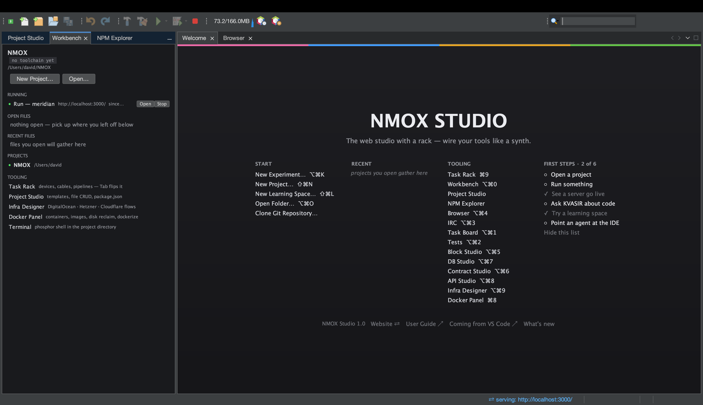
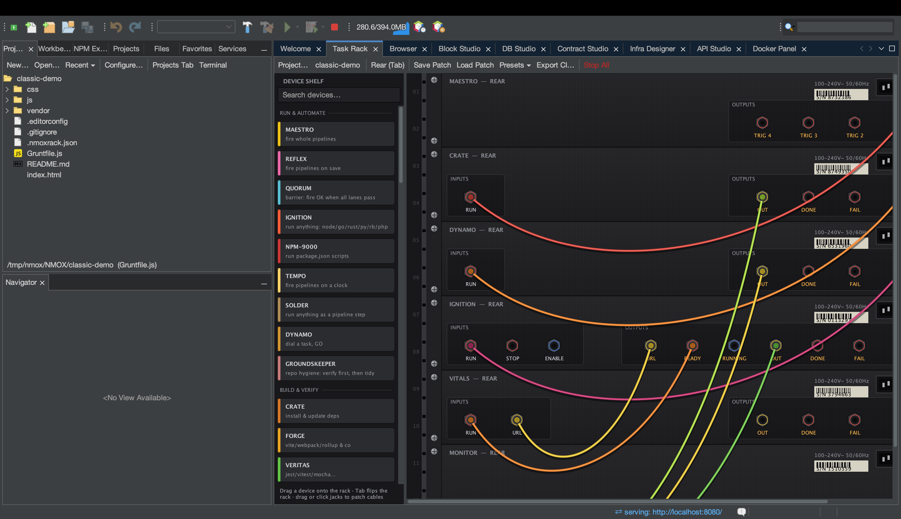
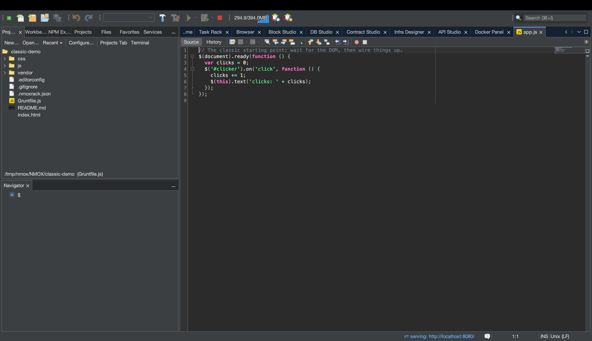
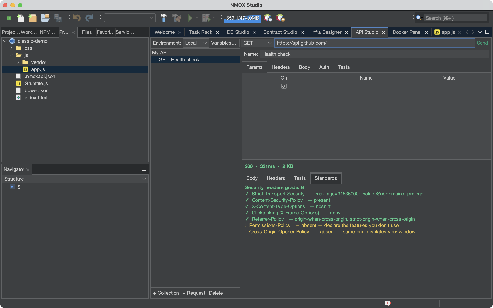

# NMOX Studio

**A desktop IDE for web developers.** Editor, debugger, browser, database
client, API client and a task runner you wire together like studio hardware,
all in one window. Free and open source (Apache-2.0), on macOS, Windows and
Linux.

[](https://github.com/NMOX/NMOX-Studio/actions/workflows/build-and-test.yml)
[](LICENSE)
[](https://github.com/NMOX/NMOX-Studio/releases/latest)
[](https://netbeans.apache.org/)

**Install:**

```bash
brew trust --cask nmox/nmox-studio/nmox-studio
brew install nmox/nmox-studio/nmox-studio
```

Not using Homebrew? [Download the latest release](https://github.com/NMOX/NMOX-Studio/releases/latest)
for macOS, Windows or Linux. Every installer includes its own Java runtime,
so there's nothing else to install ([details](#download)).

**Then:** [the five-minute quickstart](docs/quickstart.md) ·
[coming from VS Code](docs/coming-from-vscode.md) ·
[the second week](docs/tutorials/the-second-week.md) ·
[the user guide](docs/user-guide.md) · [glossary](docs/glossary.md)

`53 RACK DEVICES` · `90 LANGUAGE GRAMMARS` · `93 LEARNING SPACES` · `5 STUDIOS` · `11 CONTRACT CHAINS`





## Why this and not another IDE

**Your tooling is hardware.** Every task — install, build, test, serve,
lint, deploy — is a device on a Reason-style **Task Rack**: knobs, LEDs,
LCDs, patch cables. Wire a FAIL jack to a trigger and your lanes
coordinate themselves; one keypress runs install → build → test with the
output scrolling on a phosphor monitor. Patches persist per project, ship
as presets, export to GitHub Actions, and resurrect after a `kill -9`. The
fleet is not fixed: a JSON file in `~/.nmox/devices.d/` is a real device
on the shelf, no Java, no restart.

**The laws are tests, not intentions.** Private keys never touch the
IDE. A cloned repo's code never runs without your yes. Every read is
bounded. Secrets are keychain-only. Quitting leaves zero orphan
processes. Destructive dialogs default to the safe button. Each law was
paid for by a shipped bug and is enforced by a build-failing gate — and
every refusal speaks, so nothing fails silently.

**Five studios, one window.** Block Studio composes real Web Components
from typed pieces; API Studio is Postman-shaped with security-header
grades; DB Studio speaks six engines with bundled drivers; Contract
Studio drives eleven smart-contract chains with no key fields anywhere;
the Infra Designer draws DigitalOcean, Hetzner and Cloudflare on a
Node-RED-style canvas. Beside them: a per-project **Task Board** with
sprints, a **source-aware Browser** whose DevTools open the element's
source line, and a **Tests window** that lists every test before
anything runs.

**AI with a consent gate, not a keylogger.** **Ask KVASIR** holds a
conversation about any selection in any language; **Edit with KVASIR**
turns an instruction into a before/after preview you approve; **Complete
with KVASIR** (⌥⌘G) paints a completion as ghost text, Tab inserts;
**Draft Commit Message** writes from your staged diff; and the rack's
KVASIR device explains a failed run, API response, SQL error or page
error. Every flow earns its own consent naming exactly what leaves;
nothing is sent without a gesture; keys live in the OS keychain. **Works
with Claude, ChatGPT or Gemini** — your key, your pick, one switch for
every face.

**A polyglot editor that came to work.** 90 TextMate grammars through
NetBeans CSL, LSP with ordered fallbacks, project-wide Go to Symbol
(⌥⇧⌘O), a minimap and sticky scroll on every editor, zero-setup
JavaScript/TypeScript/Chrome debugging, color swatches that resolve
through `var()` tokens, Emmet, and Angular as the framework it is
deliberately excellent at.

**A place to learn.** 93 learning spaces generate a real project, a walked
tutorial and a rack pre-wired with a live REPL; **Check My Work** verifies
the exercises for real and offers a tutor when they fail. An 11-chain
**Contract Kit** scaffolds starters proven against their real toolchains.

**Your VS Code habits come along.** ⇧⌘P, ⇧⌘E, ⇧⌘X, ⌃\` and ⌘D do what
your hands expect, and the **VS Code** keymap profile brings the rest of
VS Code's chords; Tools ▸ Import VS Code Settings… brings your own
`settings.json` across once, when you ask; `nmox .` and
`nmox src/app.js:42` work from a terminal;
Quick Search answers to VS Code's command names; and your repository's
`.vscode/tasks.json`, `launch.json`, `settings.json`, `extensions.json`
and `*.code-snippets` are read as they are — tasks with their
`dependsOn`, inputs and problem matchers, launch configurations with
their `preLaunchTask`,
your team's snippets in completion — with whatever cannot run as written
refused by name
([coming from VS Code](docs/coming-from-vscode.md)).

Built on the NetBeans Rich Client Platform, shipped through a gated
pipeline: tests, SpotBugs, find-sec-bugs and per-module coverage floors
on every commit, three-OS CI, and an update center that has upgraded
itself across every release since v1.51.

## See it

| | |
|---|---|
|  |  |
| ***Ask KVASIR*** *— right-click any selection, or press EXPLAIN on a failed run, and keep asking follow-ups* | ***Contract Studio + Kit*** *(⌥⌘6) — eleven chains, ABI-driven Interact, live watch, no keys ever* |
|  |  |
| ***Block Studio*** *(⌥⌘5) — compose real Web Components from typed blocks; generate(parse(code)) is byte-exact* | ***DB Studio*** *(⌥⌘7) — six engines, bundled drivers, in-grid editing with previewed UPDATEs · **Task Board** (⌥⌘1) — per-project kanban: columns, drag/keyboard moves, WIP limits, `.nmoxtasks.json` beside the project* |

| | |
|---|---|
|  |  |
| *The Welcome launchpad — start actions, recent projects, First Steps* | *Flip the rack (Tab) and patch task pipelines by cable* |
|  |  |
| *An Angular template in the editor — oklch() swatches inside the style block, minimap, outline, the run in the Output* | *API Studio — a live response, graded on its security headers* |

**The go-to studio, by audience.** *Web developers*: Emmet expansion
(⌥⌘E) in HTML, Angular templates, and stylesheets; `class="…"`
completion from the project's real stylesheets with ⌘-click between a
class and its rule — both directions — and project-wide Rename Class;
your translation catalogs read the same way (Tools ▸ Check
Translations… reports missing, copied and mis-placeholdered keys across
i18next, vue-i18n, Angular XLIFF, Lingui, Paraglide and react-intl, with
key completion inside `t('…')` and ⌘-click to the source catalog);
tsserver/eslint/Prettier out of the box; breakpoints in Node and Chrome;
a Task Board (⌥⌘1) beside the code. *Designers*: color swatches on every
literal **and through `var()` tokens**, project-wide token completion
with swatch icons, ⌘-click from usage to declaration, a click-to-pick
color chooser, live viewport presets, save-to-reload. *Engineers*: a
53-device task rack that starts wired for the project's own kind — or,
for a folder with no project file, for the one script it holds — and
travels as a file (Share…/Import… — what a rack holds is shown before it
mounts, and it arrives at rest), PREFLIGHT ship gates, CI export, pull
requests on the git chip (list, review threads, checkout — through your own
`gh`),
six-engine DB Studio, multi-cloud infra designer, and an update center
that has upgraded itself across every release since v1.51.

Every screenshot is the real product. The whole thing on one page is
**[the visual tour](docs/tour.md)**; the same tour with the product's
own phosphor styling is the website, <https://nmox.github.io/NMOX-Studio/>.

## Download

Grab **[the latest release](https://github.com/NMOX/NMOX-Studio/releases/latest)** —
DMG (macOS), installer (Windows), tar.gz/deb (Linux), or portable zip.
The DMG, installer, tar.gz and deb ship with their own Java runtime —
nothing to install. (The portable zip alone expects a Java 21+ on the
machine.)

> **Windows note:** the installer is not yet signed, so SmartScreen will
> say *Windows protected your PC* the first time: click **More info**, then
> **Run anyway**. Verify the download against the GPG-signed
> [`SHA256SUMS`](#signed-checksums) first if you want more than Microsoft's
> word that it is unrecognised. Signing is on the list; what is published
> today is honest about where it stands.

> **macOS note:** the app is signed with an Apple Developer ID and
> notarized by Apple — Gatekeeper accepts it as *Notarized Developer ID*
> — with the ticket stapled to both the app and the DMG, so the first
> launch works offline and needs no right-click and no `xattr`. The
> in-app updater then keeps you current: it installs into your user
> directory rather than the app bundle, so an update never breaks the
> signature it shipped with.

### Homebrew (macOS)

```bash
brew trust --cask nmox/nmox-studio/nmox-studio
brew install nmox/nmox-studio/nmox-studio
```

The `brew trust` step is a one-time acknowledgment Homebrew requires for
any third-party tap; you won't be asked again for future updates. The
cask wraps the release DMG (bundled Java runtime, no separate install),
downloaded over HTTPS from this repo's releases and pinned by sha256.
Nothing is done to the app after it is copied: the DMG is notarized, so
Gatekeeper accepts it as it stands and the cask no longer needs to touch
the quarantine attribute. Update later with
`brew update && brew upgrade --cask nmox-studio`; remove cleanly with
`brew uninstall --cask --zap nmox-studio`.

### Staying current

The IDE updates itself in-app: **Tools ▸ Plugins ▸ Updates** offers the
product modules of any newer release, fed from the latest GitHub
release's update catalog — it has done so across every release since
v1.51.0. Once a day the studio quietly checks GitHub for a newer release
and mentions it exactly once; dev builds never check, offline never
nags, one preference turns it off. **Help ▸ What's New…** shows the
release notes bundled in the build — and, once, on the first boot after
an update, exactly the releases you have not seen.

### Signed checksums

Every release carries a GPG-signed `SHA256SUMS`: verify any download
against it with the key in [KEYS](KEYS). The macOS app and DMG are also
signed with an Apple Developer ID and notarized; the Windows installer is
not yet Authenticode-signed.

## The docs

- **[The quickstart](docs/quickstart.md)** — five minutes from download to
  your own project running.
- **[Coming from VS Code](docs/coming-from-vscode.md)** — the chords your
  hands already know (⇧⌘P, ⇧⌘E, ⇧⌘X, ⌃\`), where each VS Code idea lives
  here, and how your repository's `.vscode` tasks, launch configurations
  and settings are read.
- **[The glossary](docs/glossary.md)** — rack, patch, jack, lane, aim,
  KVASIR and the rest of the product's own words.
- **[The User Guide](docs/user-guide.md)** — the complete manual: the rack,
  the studios, the wizards, and the safety nets.
- **[The docs index](docs/README.md)** — every document, and
  **[the tutorials](docs/tutorials/README.md)** — one-sitting walkthroughs,
  one per system.
- **[The visual tour](docs/tour.md)** — every feature, one page, real
  screenshots (renders right here on GitHub).
- **[The five-minute demo script](docs/demo-script.md)** — beats, clicks,
  and what to say when you show it to a room.
- **[The Kitchen Sink](docs/kitchen-sink.md)** — the hands-on version:
  every surface exercised in one sitting, each claim matched to a proof.
- **[A Day at Meridian](docs/a-day-at-meridian.md)** — one story through
  every corner: a real site built from first experiment to standup, every
  screenshot captured live.
- **[The device reference](docs/devices.md)** — all 53 devices, generated
  from the catalog itself; CI fails if it drifts.
- **[CHANGELOG](CHANGELOG.md)** — the full release history.

The product carries its own docs, too: **Help ▸ NMOX Studio Website
(local)** serves the bundled website to you on localhost from inside the
app — the ⇄ serving chip lights on the product's own story — and the
same bytes are deployed publicly at <https://nmox.github.io/NMOX-Studio/>.

## Features

Every surface, with the proof behind each claim, is
**[the feature catalogue](docs/features.md)**. The short version:

- **The Task Rack** — 53 devices (package managers, bundlers, test runners,
  dev servers, databases, linters, git, deploy, HTTP, ssh, the KVASIR AI
  explainer, framework consoles for Angular, Vite, Next.js, Astro,
  SvelteKit, Nuxt, Phoenix and Laravel); patches persist per project, ship
  as presets, travel as files, export to GitHub Actions, and a JSON file in
  `~/.nmox/devices.d/` is a new device with no restart.
- **Quality as a shipping gate** — Lighthouse floors, coverage floors,
  bundle budgets, cert and uptime sentinels, and PREFLIGHT, the ship gate.
- **An editor to live in** — 90 grammars, LSP with ordered fallbacks,
  Go to Symbol, minimap, sticky scroll, Emmet, design-token and
  `class="…"` intelligence across stylesheets and markup, project-wide
  Rename Class, your translation catalogs checked, breakpoints in Node and
  Chrome with one session per child process and worker.
- **Angular, Vue and Svelte, first-class** — template intelligence through
  each framework's own language service, DevTools panes that read the live
  component tree.
- **The source-aware Browser** — pick an element, open its source line,
  edit a style and watch it land in the stylesheet; viewport presets;
  save-to-reload.
- **Git and GitHub, all day** — a branch chip that reads `⎇ main ±2 ↑2 ↓1`,
  line blame, conflicts resolved by Quick Fix, pull requests through your
  own `gh`; NMOX Studio as git's editor, difftool and mergetool.
- **The studios** — API Studio (Postman-shaped, security-header grades,
  imports from curl, `.http`, OpenAPI, Postman, Insomnia and HAR), DB
  Studio (six engines, bundled drivers, TLS to MySQL/MariaDB and CouchDB,
  in-grid editing with previewed UPDATEs), Contract Studio (eleven chains,
  no key fields anywhere), Block Studio (real Web Components from typed
  pieces), the Infra Designer (DigitalOcean, Hetzner, Cloudflare), and the
  Task Board with sprints and a standup button.
- **Learning Spaces** — 93 built-in tutorials, each a real project with a
  pre-wired rack and an in-rack REPL, and Check My Work.
- **Made to be shown** — Presentation Mode, Show Keystrokes, Copy as
  Markdown, screenshots the product takes of itself.
- **Honest about your machine** — the Environment Doctor probes every tool
  the product can drive; the Standards, PWA, A11y, I18n, Image, Classic and
  Contract kits add to a project without clobbering a byte.
- **Fifteen languages**, two of them right to left, in the chrome, the
  catalogue and the docs.

## The Agent Port (MCP)

Tools ▸ **Agent Port (MCP)…** starts a Model Context Protocol server any
agent can connect to — loopback only, a bearer token, **read-only by
construction** (a build-failing ledger bans every spawn, write and stop
primitive from the package): twelve typed tools, `nmox://` resources,
prompts that fold live state in, and an event stream. The status line wears
a `⌁ agent port :N` chip while it runs. The full account is in
[the feature catalogue](docs/features.md#the-agent-port-mcp) and
[the tutorial](docs/tutorials/agent-port.md).

## Build from source

### Prerequisites

- **JDK 25** to build. The build refuses an older JDK by name at its
  first step; on macOS, `brew install openjdk@25` and point `JAVA_HOME`
  at it (the full line is in [CONTRIBUTING.md](CONTRIBUTING.md#build-and-run)).
  The bytecode still targets Java 21 and the installers bundle their own
  runtime, so JDK 25 is needed only to build. The portable zip runs on
  any Java 21 or newer.
- **Maven 3.6.3+**
- **Git**

### Build and run

```bash
git clone https://github.com/NMOX/NMOX-Studio.git
cd NMOX-Studio

./build.sh             # mvn clean install -DskipTests, after checking the JDK
./run.sh               # boots the assembled app with its own userdir/
./build.sh --verify    # the whole gate: tests, SpotBugs, find-sec-bugs, JaCoCo floors
```

The assembled app is `application/target/nmoxstudio/`. The installers
(DMG, `.deb`, `.tar.gz`, Windows setup, portable zip) are built from it
by the release workflow, `.github/workflows/release.yml`, with the
scripts in `packaging/`.

### Working on it

Rebuilding one module, running a single test the reliable way, booting
with a throwaway userdir, and what to do when a gate fails are all in
[CONTRIBUTING.md's inner loop](CONTRIBUTING.md#the-inner-loop); the
module map and the architecture are in
[CONTRIBUTING.md's "The modules"](CONTRIBUTING.md#the-modules). Every
change rides `mvn clean verify` (tests plus the SpotBugs, find-sec-bugs
and JaCoCo gates) before it becomes a pull request.

## Contributing

We welcome contributions! Please see [CONTRIBUTING.md](CONTRIBUTING.md) for details on:
- Code of conduct
- Development workflow
- Pull request process
- Coding standards

## License

This project is licensed under the Apache License, Version 2.0 - see the [LICENSE](LICENSE) file for details.
It builds on the Apache NetBeans Platform and shares its license.
(Vendored third-party components keep their own licenses, listed in the NOTICE files beside them.)

## Support

- **Issues**: [GitHub Issues](https://github.com/NMOX/NMOX-Studio/issues)
- **Discussions**: [GitHub Discussions](https://github.com/NMOX/NMOX-Studio/discussions)
- **Documentation**: [the docs index](docs/README.md) — start with [the quickstart](docs/quickstart.md)
- **Bugs**: **Help ▸ Report a Problem…** in the app prepares a report with the log tail and your environment, for you to read before you send it

---

**NMOX Studio** - wire your web tooling like a synth.
